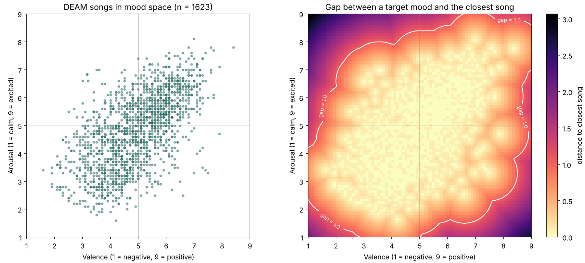
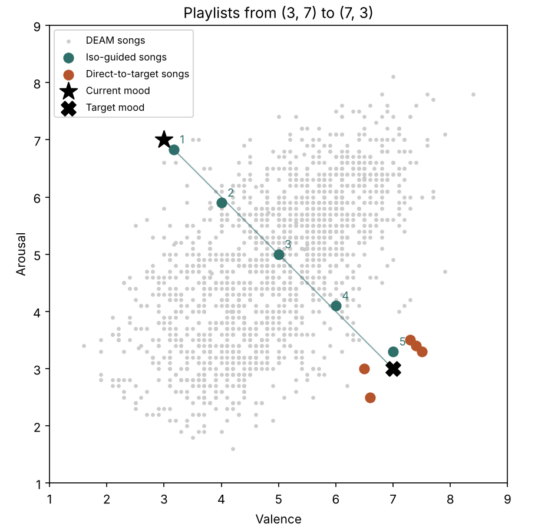

# IsoHarmonix

An adaptive, Iso-Principle music assistant for everyday mood regulation.
Team 9: Alison Wu, Lisa Wang, Tiffany Chiang, Melody Huang (AI for Healthcare, Fall 2026).

The first song matches the listener's current mood, and each next song moves one
step closer to the target mood. We compare this **iso-guided** playlist with a
**direct-to-target** playlist (all songs at the target mood).

## Timeline progress

| Weeks | Task | Owner | Status |
|---|---|---|---|
| 9/29 | Proposal | All | Done |
| 10/6 to 10/20 | DEAM loading, cleaning, coverage plot | A | **Done** (notebook Parts 1 to 3) |
| 10/6 to 10/20 | Path planner + song retrieval | B | **Done** (notebook Parts 4 to 6) |
| 10/13 to 10/27 | Simple app: sliders, playback, why-card | C | To do (the why-card text is ready, see below) |
| 10/13 to 10/27 | Questionnaire + study protocol | D | To do |
| 10/27 | Integration + pilot (checkpoint) | All | To do |
| 11/3 to 11/17 | User study sessions | C, D | To do |
| 11/17 to 12/1 | Analysis, explainability, bias | A, B | To do |
| 12/1 to 12/10 | Final report + presentation | All | To do |

## Setup

```bash
pip install -r requirements.txt
```

Download the [DEAM dataset from Kaggle](https://www.kaggle.com/datasets/imsparsh/deam-mediaeval-dataset-emotional-analysis-in-music)
and unzip it into `data/DEAM/`. The exact folder layout inside does not matter:
the loader searches for these files:

- `static_annotations_averaged_songs_1_2000.csv`
- `static_annotations_averaged_songs_2000_2058.csv`
- the MP3 clips, named `<song_id>.mp3`

`data/` is in `.gitignore`, so the dataset is never committed.

## Usage

All the work is in one notebook:
[`notebooks/IsoHarmonix_data_and_planner.ipynb`](notebooks/IsoHarmonix_data_and_planner.ipynb)

```bash
jupyter notebook notebooks/IsoHarmonix_data_and_planner.ipynb
```

Run all cells from top to bottom. The notebook also works in Google Colab: if
`data/DEAM/` is not found, it tries to download DEAM with `kagglehub` (needs a Kaggle
API token).

| Part | Content | Output |
|---|---|---|
| 0 | Setup and fixed rules | |
| 1 to 2 | Load and clean DEAM | `data/songs_clean.csv` |
| 3 | Coverage plot and gap table | `results/coverage_plot.png`, `results/coverage_grid.csv` |
| 4 to 5 | Path planner and song retrieval | `results/example_session.csv`, `results/example_paths.png` |
| 6 | Checks on a toy song set | |
| 7 to 8 | Match quality and points for the team | |

**For the app (Tiffany):** `build_session(retriever, Mood(3, 7), Mood(7, 3))` returns
one row per song with `condition` ("iso"/"direct"), `step`, the step's target, the
song's DEAM ratings, `distance`, `gap_warning`, `audio_path` and `why` (the why-card text).

## How it works

1. **Mood input:** current and target mood, each a (valence, arousal) point on 1 to 9.
2. **Path planner**
   - *Iso-guided:* 5 evenly spaced points from the current mood to the target. Song 1 matches, song 5 reaches the target.
   - *Direct-to-target:* all 5 points at the target.
3. **Song retrieval:** for each point, the closest unused DEAM song by Euclidean distance (scikit-learn `NearestNeighbors`).
   In one session, no song appears in both playlists. The iso playlist is built first, then the direct playlist uses the songs that are left.
4. **Why-card:** each song comes with a sentence like
   *"Song 2 of 5. Target for this step: valence 4.0, arousal 6.0. This song is rated valence 4.0, arousal 5.9 by DEAM listeners. It was the closest unused song to the target (distance 0.10)."*

All fixed rules (5 steps, Euclidean distance, spread cutoff, gap warning) are in
the "Fixed rules" cell in Part 0 of the notebook. They should be frozen before the pilot.

## Data cleaning rules

| Issue (from proposal) | What the code does |
|---|---|
| Songs missing a rating or audio file | Dropped. The audio check runs only when MP3 files are found. |
| Raters disagree (possible mislabels) | Spread = (valence_std + arousal_std) / 2. Songs above the 90th percentile are dropped. |
| Songs uneven across the mood space | Coverage plot and gap table, plus a `gap_warning` flag on any song more than 1.0 from its target. |

## First results (DEAM ratings only, before adding audio)

From the notebook:

- 1,802 raw songs, 179 dropped for high rater spread (spread > 1.885), **1,623 clean songs**.
- Median gap from an integer slider setting to the closest song: 0.63. Only **64%** of the 81 slider settings have a song within 1.0.
- The corners are empty. The worst targets are (1, 9) "very tense", gap 3.07, and (9, 1) "very calm and happy", gap 2.75. Most songs lie on a diagonal from sad/calm to happy/excited.



Example session, current mood (3, 7) "tense", target (7, 3) "calm and content":



## Points for the team to decide before the pilot

1. **Match quality differs between conditions.** The direct playlist needs 5 songs
   at the same point, so its songs are further from their target. Over 300 random
   mood pairs, the mean distance was **0.57 for iso and 1.10 for direct**. This could
   be a confound, so we should report `match_quality()` for every participant, and
   maybe restrict study targets to well-covered areas.
2. **Slider limits.** Because the corners have no songs, we could limit the sliders
   (for example to 2 to 8), or show the gap warning in the app.
3. **Spread cutoff.** 90th percentile is our current choice. Please confirm before we freeze it.
